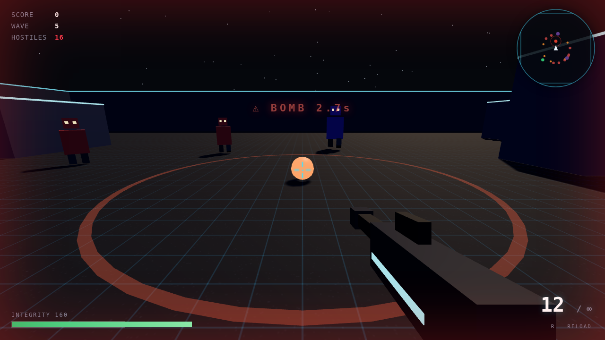
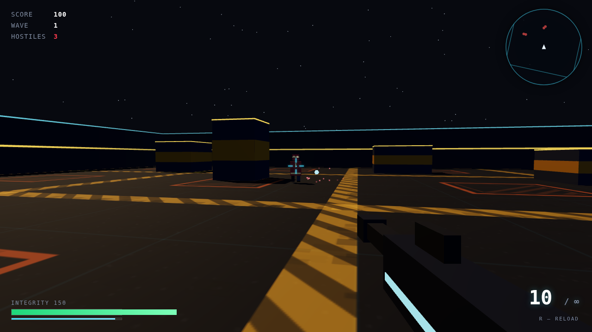

# NEON ARENA — 3D Arena Shooter

A browser-based first-person 3D arena shooter built with [Three.js](https://threejs.org/).
Survive escalating waves of hostile robots in a dark industrial arena.

Built with **Vite + TypeScript**.

---

## Screenshots



A **Sapper** has just planted a bomb mid-wave: the blast ring is marked on the
floor, the `BOMB` countdown is up, and the radar (top right) shows the pack
closing in — including the sapper's green blip.

| | |
|:---:|:---:|
|  |  |
| *A hitscan tracer, sparks and the hitmarker; the magazine counter already at 4.* | *Robot types read by colour and silhouette; the radar mirrors each one as a blip.* |
|  |  |
| *XP crystals drop from kills, sprint stamina gets its own gauge, and upgrades have grown integrity to 150.* | *Every mark on the floor is procedural: hazard lanes, warning plates, striped cover blocks.* |

---

## Features

- **FPS controls** — WASD movement, mouse look via Pointer Lock, sprint, jump
- **Weapon system** — 12-round magazine, infinite reserve, reload, recoil kick, muzzle flash, spread bloom
- **Four enemy types**
  | Type | HP (wave 1) | Speed | Damage | Score | Behaviour |
  |---|---|---|---|---|---|
  | Grunt | 60 | 3.4 | 10 | 100 | Standard chaser |
  | Runner | 30 | 6.2 | 7 | 150 | Fast, fragile |
  | Tank | 200 | 2.2 | 22 | 300 | Slow, high HP, big damage |
  | Sapper | 90 | 4.2 | 12 | 250 | Stalks from range and plants bombs; charges once fewer than 5 hostiles remain |
- **Sapper & bombs** — from wave 5 a sapper stalks you, keeping its distance and planting a fused bomb every 6 seconds (thrown at you from afar, dropped in its tracks up close). Shoot a live bomb to defuse it for bonus points; leave it and the blast hurts you *and* nearby enemies. The tab reddens and a tone sounds when a bomb lands close
- **Minimap** — top-right radar: you at the centre pointing up, enemies blipped in their own colours, live bombs shown with their blast radius
- **Wave system** — enemy count, HP and speed scale per wave; clearing a wave restores 25 HP
- **Headshots** — deal 2.5× damage and a score bonus
- **Feedback** — hitmarkers, enemy health bars, damage vignette, screen shake, particles, tracers
- **Procedural audio** — Web Audio API synth, no sound files needed
- **HUD** — score, wave, hostile count, integrity bar, ammo counter, reload progress
- **Crosshair settings** — 7 presets (default, dot, circle, triangle, square, diamond, cross) plus a full tune panel: line length/thickness/gap, dot size, outer shape, outline, colour and outline colour, bloom spread, dim-when-still. Opens from any screen with `C`, and your choices are saved to `localStorage`
- **Pause / game over / restart** flow

---

## Requirements

- **Node 20+** (developed on Node 24)
- A modern browser with **WebGL**: Chrome, Edge, Firefox, or Safari (2019+)

There are no sound files, no textures on disk and no API keys — everything is
procedural, and Three.js is bundled from npm at build time. Nothing is fetched
from a CDN at runtime.

---

## Setup & Running

```bash
git clone https://github.com/farzadtaherzade/neon-arena.git
cd neon-arena
npm install
npm run dev
```

Vite prints a URL (default <http://localhost:5173>) and hot-reloads on save.

> Click **CLICK TO DEPLOY** to start. The game requests mouse pointer lock —
> accept it, or aiming won't work. `Esc` pauses and releases the cursor.

### Production build

```bash
npm run build      # type-checks nothing, emits dist/
npm run preview    # serves dist/ exactly as deployed
```

### All the checks

```bash
npm run check      # tsc --noEmit + biome + vitest
```

| Script | What it does |
|---|---|
| `npm run dev` | Vite dev server with HMR |
| `npm run build` | Production bundle into `dist/` |
| `npm run preview` | Serve `dist/` locally |
| `npm run typecheck` | `tsc --noEmit`, strict |
| `npm run lint` | Biome lint + format check |
| `npm run format` | Biome, write fixes |
| `npm test` | Vitest unit suites (Node, no browser) |
| `npm run test:e2e` | Playwright against the production build |

---

## Controls

| Input | Action |
|---|---|
| `W` `A` `S` `D` | Move |
| `Mouse` | Look / aim |
| `Left Mouse` | Shoot |
| `R` | Reload |
| `Shift` | Sprint |
| `Space` | Jump |
| `C` | Crosshair settings (any time) |
| `Esc` | Pause / release cursor — or close the settings panel |

---

## Project Structure

```
neon-arena/
├── index.html                markup only — no inline CSS or JS
├── vite.config.ts            dev server, build, and the Vitest config
├── playwright.config.ts      E2E against `vite preview`
├── biome.json                lint + format rules
├── tsconfig.json             strict TypeScript
├── src/
│   ├── main.ts               bootstrap, fixed-timestep loop, window.__NEON
│   ├── styles.css            all styling
│   ├── app/
│   │   └── Game.ts           composition root + game state machine
│   ├── core/                 pure, no three, no DOM
│   │   ├── rng.ts            seeded PRNG (mulberry32)
│   │   ├── math.ts           clamp + frame-rate-independent damping
│   │   └── loop.ts           fixed-timestep accumulator
│   ├── game/                 pure simulation — no three, no DOM
│   │   ├── config.ts         every gameplay tunable; imports nothing
│   │   ├── player.ts         movement, gravity, look angles, bob
│   │   ├── weapon.ts         magazine, reload, recoil/bloom/spread
│   │   ├── enemy.ts          one hostile: steering, health, death clock
│   │   ├── enemies.ts        spatial hash for enemy separation
│   │   ├── bomb.ts           a planted bomb: fuse, radius, detonation
│   │   ├── minimap.ts        player-up world→radar projection (pure)
│   │   ├── waves.ts          wave composition, spawn pacing, intermission
│   │   ├── fx.ts             particle pool + tracer ring
│   │   └── world/
│   │       ├── collision.ts  circle-vs-box push-out
│   │       └── layout.ts     obstacle table + starfield generation
│   ├── render/               the Three.js adapter — the only place that imports it
│   │   ├── Arena.ts          renderer, scene, camera rig, world meshes
│   │   ├── Pick.ts           one raycast per shot
│   │   ├── Gun.ts            first-person viewmodel
│   │   ├── EnemyView.ts      one enemy's meshes
│   │   ├── BombView.ts       a bomb's meshes + blink
│   │   ├── Fx.ts             points + lines wrapping the pure pools
│   │   ├── Materials.ts      shared geometry/material cache
│   │   └── Textures.ts       procedural floor texture
│   ├── audio/Sfx.ts          Web Audio synth
│   └── ui/
│       ├── Hud.ts            all DOM reads/writes
│       ├── Minimap.ts        canvas radar drawing
│       ├── Settings.ts       crosshair presets, live tuning, localStorage
│       └── Input.ts          keyboard, mouse, pointer lock
└── tests/
    ├── unit/                 Vitest — pure logic, runs in Node
    └── e2e/smoke.spec.ts     Playwright — the built game in a real browser
```

### Architecture

- **Layers, not a god object.** `core/` and `game/` are pure: no Three.js, no
  DOM, no `window`. They take numbers and return numbers, which is why the
  interesting logic is unit-testable in Node. `render/` is the only layer that
  knows Three.js exists; `app/Game.ts` is the only file that knows about all of
  them.
- **Pure code never calls back up.** `Enemy.update(dt, world)` receives the
  handful of things it needs (`playerPos`, `neighbours`, `collide`,
  `damagePlayer`) instead of the whole `Game`, so the dependency is explicit
  and testable. The same idea carries `Weapon`'s hooks and `Input`'s hooks.
- **State lives with its owner.** Player position is on `Player`, ammo and recoil
  on `Weapon`, the wave on `WaveDirector`; only true game state (`hp`, `score`,
  `wave`, `state`, feedback timers) lives on `Game`.
- **Fixed timestep.** The simulation advances in whole 1/60 s slices regardless
  of frame rate, capped at 5 steps per frame so a backgrounded tab cannot spiral.
  Rendering happens once per animation frame.
- **Seeded RNG.** One `Rng` drives every random decision — spawn ring, spread
  roll, starfield, floor grain — so a seed replays the same run and tests can
  assert on it. There is no `Math.random()` in game logic.
- **Hot paths are pooled.** Particles and tracers are pre-allocated typed arrays;
  the wave director reuses its output array; enemy separation uses a spatial
  hash instead of the old all-pairs scan.
- **Shared GPU resources are cached in `render/Materials.ts`** and must never be
  mutated or disposed. The exception is an enemy's body/head/leg materials,
  which stay per-enemy because the hit flash writes `emissive` on them.

---

## Tuning the Game

Everything a designer is likely to change is in `src/game/config.ts`, grouped by
concern — `WORLD`, `WEAPON`, `CAMERA`, `FEEDBACK`, `ENEMY_TYPES`, `ENEMY`,
`WAVES`, `FX`. Each group is `as const`, so a typo is a compile error rather
than an `undefined` at 3 a.m. Mesh-local dimensions (a wall's thickness, a
barrel's length) stay in the module that owns that mesh.

```ts
export const WEAPON = {
  MAG: 12, RELOAD_T: 1.25, FIRE_T: 0.12,
  DMG: 34, HEAD_MULT: 2.5, HEADSHOT_BONUS: 25, SENS: 0.0023,
  // ...
} as const;
```

---

## Testing

Append `?test` to the URL (e.g. `http://localhost:5173/?test`) to boot straight
into a run without clicking and without requesting pointer lock.

### Unit tests (Vitest)

Pure logic only, so they run in Node in about a second:

```bash
npm test
```

- `core` — the RNG is deterministic and uniform, damping is frame-rate
  independent, and the fixed loop survives jittery frames and long stalls
- `collision` — walls clamp, obstacles push out, embedded circles escape by the
  nearest face; the arena layout fits inside the arena and leaves the spawn clear
- `player` — gravity, jumping, damping, diagonal normalisation, no tunnelling
- `weapon` — fire rate, auto-reload, dry fire, bloom clamp and decay, headshot damage
- `enemy` / `enemies` — damage, death clock, attack cooldown, separation. The
  spatial hash is run against the all-pairs loop it replaced: two identical
  populations stepped side by side must end up in the same places
- `waves` — composition, the scaling curve, spawn spacing, intermission
- `fx` — pool wrap-around, gravity, floor bounce, fade, tracer ring reuse
- `settings` — clamping, colour validation, persistence, corrupt storage
- `config` — the tuning table is present, ordered and in range

### End-to-end test (Playwright)

```bash
npx playwright install chromium   # first time only
npm run test:e2e
```

It builds the app, serves `dist/` with `vite preview`, and drives the real
browser: boot with no console errors, wave spawn, look, shoot, reload, GPU
resource convergence (the old code leaked two geometries per enemy), damage,
death, and the crosshair panel. Waits are condition-based, so it works on
software rendering as well as a GPU.

### Manual / automation hooks

`window.__NEON` is exposed for debugging and automation:

```js
__NEON.stats()            // { state, hp, ammo, score, kills, wave, hostiles }
__NEON.hurt(d)            // damage the player (negative heals)
__NEON.teleportEnemies(d) // move all enemies to radius d around the player
__NEON.faceEnemies(d, y)  // line enemies up in front of the player and aim at them
__NEON.aim(yaw, pitch)
__NEON.enemyPos()         // positions / state / hp of all enemies
__NEON.camState()         // player position and camera angles
__NEON.renderInfo()       // draw calls, geometry/texture counts — leak checks
__NEON.gunVisible()       // is the first-person weapon on screen
__NEON.bombs()            // remaining fuse of every live bomb
__NEON.spawnBomb(x, z)    // plant a bomb at a spot (automation)
__NEON.forceWave(n)       // jump straight to wave n
__NEON.crosshair()        // current crosshair settings
__NEON.setCrosshair(patch)// merge a partial change, e.g. { shape: 'circle', color: '#ff0000' }
```

---

## Deployment

`npm run build` produces a fully static `dist/`. Upload **that folder** to any
static host.

### Docker

```bash
docker build -t neon-arena .

# `-p` publishes the container's port 80 on the host, all interfaces (0.0.0.0)
docker run --rm -d -p 8080:80 neon-arena

# open http://localhost:8080
```

> In environments where npm only runs behind a local proxy (e.g. the dev
> machine's `127.0.0.1:10808`), the build needs it passed explicitly:
> `docker build --network host --build-arg HTTP_PROXY=$HTTP_PROXY
> --build-arg HTTPS_PROXY=$HTTPS_PROXY -t neon-arena .`


### GitHub Pages

```bash
npm run build
git add dist
git commit -m "build"
git push
```

Then **Settings → Pages → Deploy from a branch → `main` / `dist`**.

For a clean history, use a GitHub Action running `npm ci && npm run build` and
uploading `dist/` as the Pages artifact instead of committing the build.

### Netlify / Vercel / Cloudflare Pages

Build command `npm run build`, output directory `dist`.

---

## Troubleshooting

**Black screen** — WebGL is disabled. Enable hardware acceleration, or update
graphics drivers.

**Mouse doesn't move the camera** — pointer lock wasn't granted. Click the canvas
to re-acquire it. Embedded previews and cross-origin iframes often block it.

**`npm run dev` fails on install** — check `npm config get registry`; the build
was developed against `https://registry.npmjs.org`.

**E2E fails on boot** — run `npx playwright install chromium` first.

**Changes to `src/game/` don't show up** — they should; the dev server is plain
Vite with no plugin layer. If they don't, check `npm run typecheck` first — a
type error can leave a stale bundle.