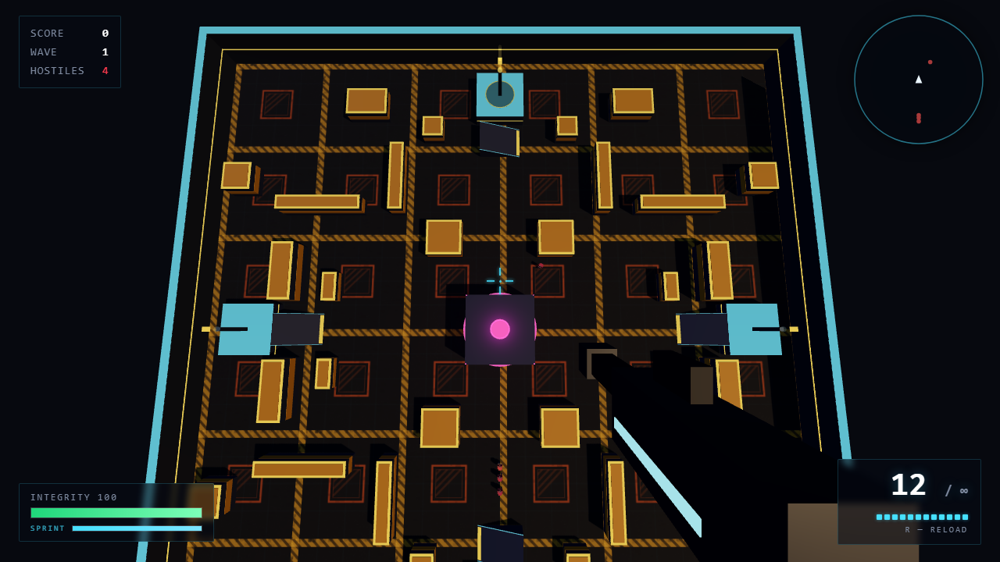
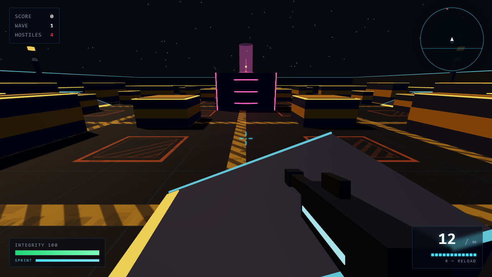
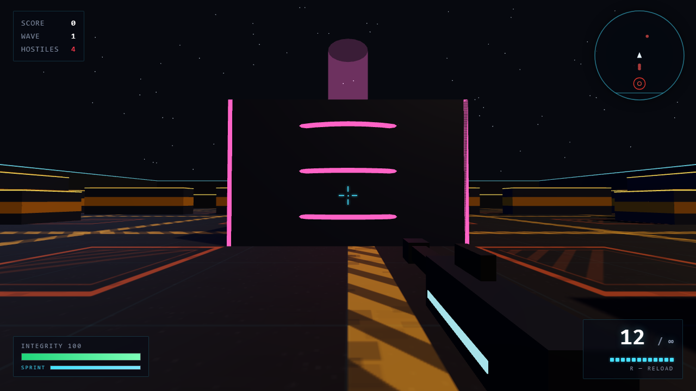
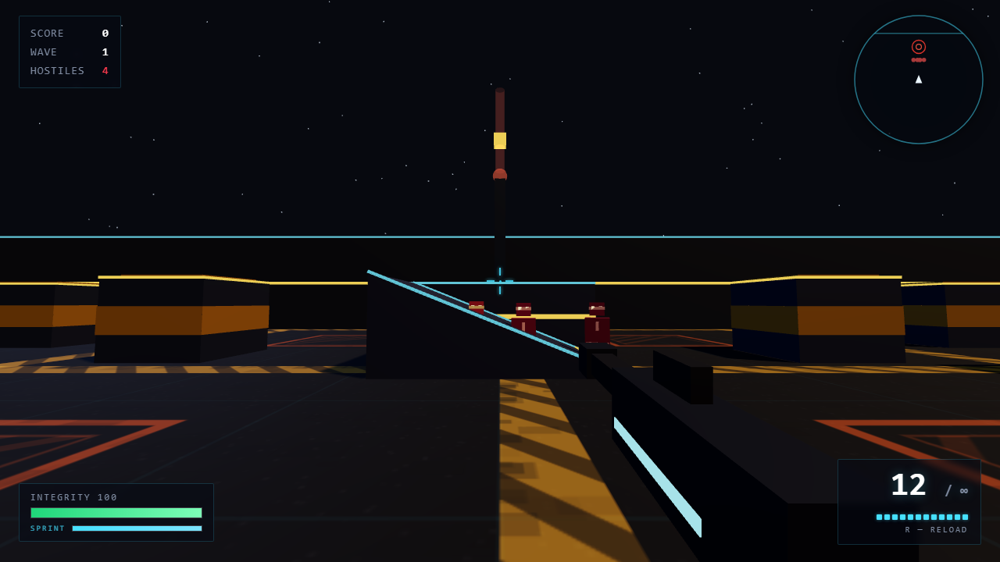
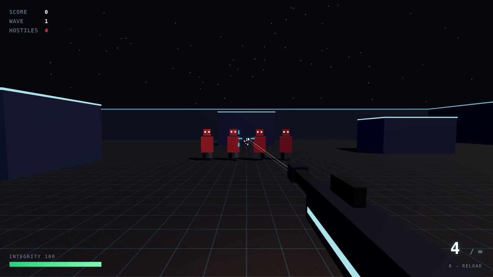
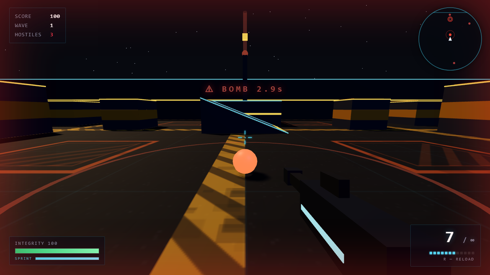
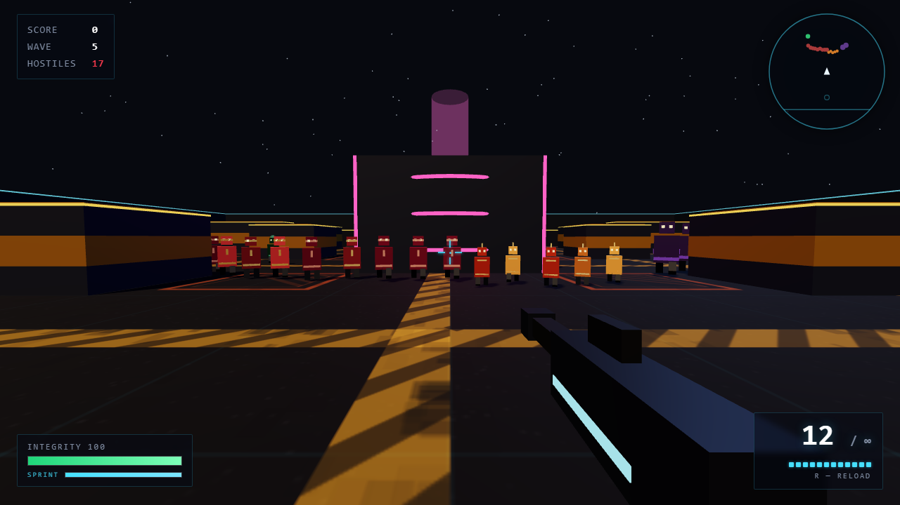
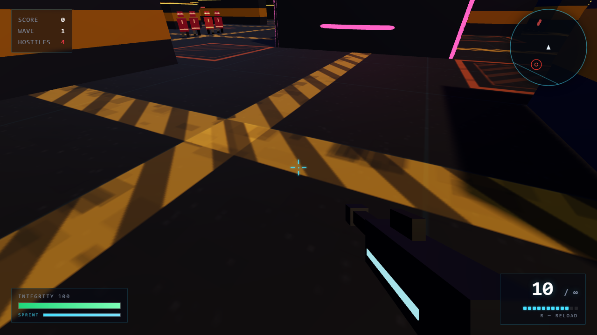
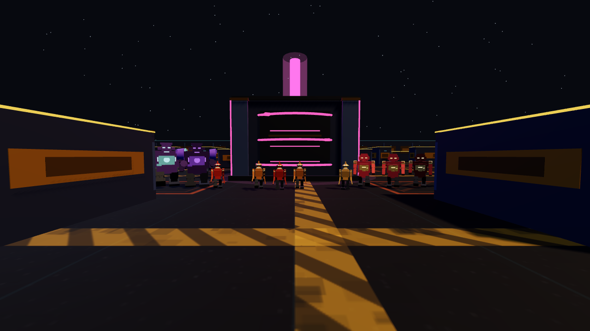
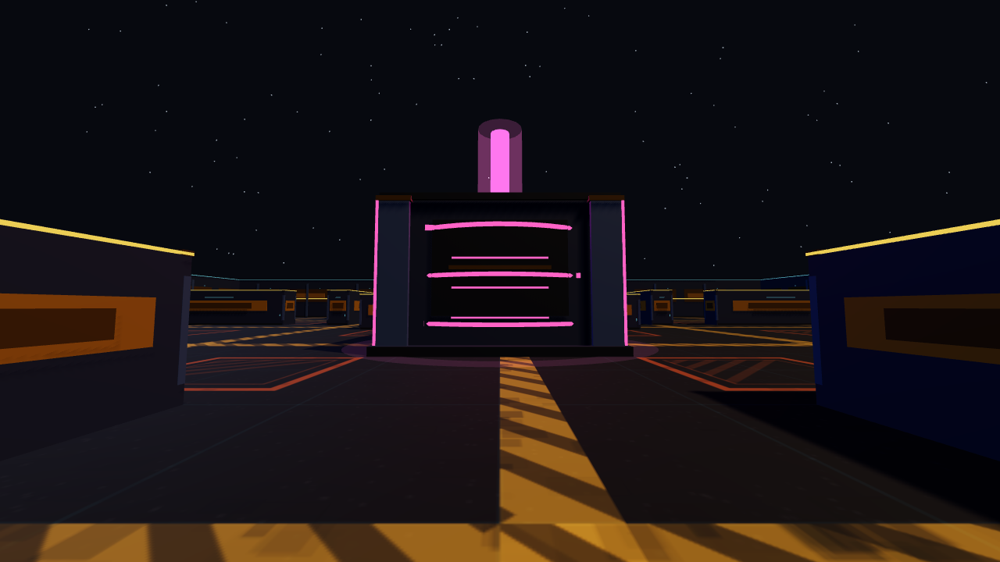

# NEON ARENA — 3D Arena Shooter

A browser-based first-person 3D arena shooter built with [Three.js](https://threejs.org/).
Survive escalating waves of hostile robots across an 84 × 84 maze of cover
blocks, gatehouse towers and a central reactor.

Built with **Vite + TypeScript**.

---

## Screenshots



The whole floor at a glance: 32 cover blocks mirrored four ways, the four cyan
gatehouse decks on the mid-edges, and the magenta reactor every lane is
navigated by.

| | |
|:---:|:---:|
|  |  |
| *On a gatehouse deck: capture pad underfoot, the ramp down, the maze laid out below.* | *The reactor — dark monolith, magenta containment rings, lit corner edges.* |
|  |  |
| *Tower alarm: hostiles at the base turn the beacon red and pulse a ring on the radar.* | *A hit lands — flash, health bar, and the magazine counting down.* |
|  |  |
| *A live bomb: blast ring on the floor, `BOMB 2.9s`, the tab reddening.* | *Wave 5: grunts, runners, a tank and sappers — colour and silhouette, mirrored by the radar blips.* |



Every mark on the floor is drawn in code: hazard lanes, warning plates and the
orange loading-zone squares repeat on a 14-unit grid.

---

## 3D asset kit

The game still ships with **no model files**: the robot rigs and structures are
built from primitives at boot, then merged into a handful of shared GPU buffers.

- **Four articulated mobs** — grunt, runner, tank and sapper each have their own
  silhouette, armour, equipment and glow language. Arms counter-swing against
  the legs, and the melee flash drives a short strike animation.
- **Industrial structures** — cover blocks, gatehouse decks, perimeter walls,
  ramps and the reactor are assembled by `src/render/models/StructureKit.ts`.
  Each asset bakes its palette into vertex colours and draws as one lit mesh plus
  one neon trim mesh.
- **Collision stays authoritative** — `Arena` registers authored AABBs from
  `layout.ts`, not from decorative overhang, so a trim strip can never narrow a
  corridor or widen a ramp.

| | |
|:---:|:---:|
|  |  |
| *The four mob rigs, sharing one geometry cache per kind.* | *Reactor: stepped shell, containment rings, core column and floor halo.* |

---

## Features

- **FPS controls** — WASD movement, mouse look via Pointer Lock, sprint, jump
- **The arena** — 84 × 84 of dense maze: 32 cover blocks mirrored four ways around a central reactor, with four gatehouse decks on the mid-edges. Symmetric, so every lane has a twin across the centre
- **Deck capture** — one gatehouse per wave carries a live pad. Hold it for 4 seconds to repair 30 HP, then that deck cools down for 40; the live pad rotates with the wave, so the objective keeps moving and the climb is never free
- **Alarm towers** — every gatehouse has a beacon: amber on the deck you can take, dim cyan on the other three, and red with a siren ping and a pulsing radar ring when hostiles mass at its base
- **Weapon system** — 12-round magazine and a **finite reserve** (60 rounds to start, 120 max). Kills drop ammo (4–12 rounds by mob type) and every wave resupplies 24 rounds. Reload draws from the reserve; when the magazine *and* the reserve are empty the rifle is dry — it clicks instead of firing
- **Knife** — `Q` swings a blade at anything in a 110° arc within 2.4 m, for 70 damage. A blade ignores armour, so it one-shots a grunt and a runner, and it is always there when the rifle is dry
- **Four enemy types**, each with one signature verb
  | Type | HP (wave 1) | Speed | Damage | Score | Behaviour |
  |---|---|---|---|---|---|
  | Grunt | 60 | 3.4 | 10 | 100 | Carries a front shield: shots from the front lose 60% of their damage. Flank it, headshot it, or stab it |
  | Runner | 30 | 6.2 | 7 | 150 | Crouches, then pounces at 2.2× speed, and staggers afterwards |
  | Tank | 200 | 2.2 | 22 | 300 | Ground slam: a 2.6 m shockwave that knocks you back, behind a 40% front plate |
  | Sapper | 90 | 4.2 | 12 | 250 | Stalks from range and plants bombs; below 35% HP it panics and runs, dropping bombs at its feet |
- **Four robot silhouettes** — each type is an articulated low-poly rig with its own armour, backpack, weapon and glow accents; the set is generated in code and shared through a per-kind geometry cache
- **Sapper & bombs** — from wave 5 a sapper stalks you, keeping its distance and planting a fused bomb every 6 seconds (thrown at you from afar, dropped in its tracks up close). Shoot a live bomb to defuse it for bonus points; leave it and the blast hurts you *and* nearby enemies. The tab reddens and a tone sounds when a bomb lands close
- **Meteor shower** — every so often the sky bleeds red and the floor starts filling with warning rings: a stone is about to land there. The blast hurts you (less the further you run) and the mobs around it, shakes the screen and throws debris. The sky fades back to normal when the shower ends
- **XP and levels** — every kill drops an orb; get close and it is magnetised to you. The bar under the integrity bar fills towards the next level, and each level up pays a 15 HP repair — deliberately less than a capture, so a secured deck stays the premium heal. Orbs are XP only: the score comes from kills, headshots and defused bombs
- **Minimap** — top-right radar: you at the centre pointing up, enemies blipped in their own colours, live bombs shown with their blast radius, gatehouses marked (red pulse while their alarm is up)
- **Tactical map** — `M` or `Tab` opens a full-screen map of the whole arena: the maze, the ramps, the decks, the reactor, the clock tower, live bombs and every hostile. The game pauses while it is open
- **Wave system** — enemy count, HP and speed scale per wave; clearing a wave restores 25 HP
- **Headshots** — deal 2.5× damage and a score bonus
- **Feedback** — hitmarkers, enemy health bars, damage vignette, screen shake, particles, tracers
- **Procedural audio** — Web Audio API synth, no sound files needed
- **HUD** — score, wave, hostile count, integrity bar, XP bar and level, sprint gauge, ammo counter with the remaining reserve, reload progress, deck-capture bar. When the rifle runs dry the reload hint turns into "Q — KNIFE"
- **Settings, in three tabs** — `C` opens the panel from any screen, and everything is saved to `localStorage`:
  - **Crosshair** — 7 presets (default, dot, circle, triangle, square, diamond, cross) plus a full tune panel: line length/thickness/gap, dot size, outer shape, outline, colour and outline colour, bloom spread, dim-when-still
  - **Game** — mouse sensitivity, invert Y, field of view, mute
  - **Video** — render quality (pixel ratio), shadows, fog
- **Main menu** — the game waits on a menu with DEPLOY, SETTINGS and CONTROLS, and the pause and game-over screens both offer a way back to it
- **Pause / game over / restart** flow

---

## Requirements

- **Node 20+** (developed on Node 24)
- A modern browser with **WebGL**: Chrome, Edge, Firefox, or Safari (2019+)

There are no sound files, no textures on disk and no API keys — everything is
procedural, and Three.js is bundled from npm at build time. Nothing is fetched
from a CDN at runtime.

---

## Setup & Running

```bash
git clone https://github.com/farzadtaherzade/neon-arena.git
cd neon-arena
npm install
npm run dev
```

Vite prints a URL (default <http://localhost:5173>) and hot-reloads on save.

> Click **DEPLOY** on the main menu to start. The game requests mouse pointer
> lock — accept it, or aiming won't work. `Esc` pauses and releases the cursor.

### Production build

```bash
npm run build      # type-checks nothing, emits dist/
npm run preview    # serves dist/ exactly as deployed
```

### All the checks

```bash
npm run check      # tsc --noEmit + biome + vitest
```

| Script | What it does |
|---|---|
| `npm run dev` | Vite dev server with HMR |
| `npm run build` | Production bundle into `dist/` |
| `npm run preview` | Serve `dist/` locally |
| `npm run typecheck` | `tsc --noEmit`, strict |
| `npm run lint` | Biome lint + format check |
| `npm run format` | Biome, write fixes |
| `npm test` | Vitest unit suites (Node, no browser) |
| `npm run test:e2e` | Playwright against the production build |

---

## Controls

| Input | Action |
|---|---|
| `W` `A` `S` `D` | Move |
| `Mouse` | Look / aim |
| `Left Mouse` | Shoot |
| `F` or `V` | Shoot (keyboard trigger — for touchpad players) |
| `R` | Reload |
| `Q` | Knife |
| `Shift` | Sprint |
| `Space` | Jump |
| `C` | Settings panel (any time) |
| `M` or `Tab` | Tactical map — the game pauses while it is open |
| `Esc` | Pause / release cursor — or close the settings panel |

---

## Project Structure

```
neon-arena/
├── index.html                markup only — no inline CSS or JS
├── vite.config.ts            dev server, build, and the Vitest config
├── playwright.config.ts      E2E against `vite preview`
├── biome.json                lint + format rules
├── tsconfig.json             strict TypeScript
├── src/
│   ├── main.ts               bootstrap, fixed-timestep loop, window.__NEON
│   ├── styles.css            all styling
│   ├── app/
│   │   └── Game.ts           composition root + game state machine
│   ├── core/                 pure, no three, no DOM
│   │   ├── rng.ts            seeded PRNG (mulberry32)
│   │   ├── math.ts           clamp + frame-rate-independent damping
│   │   └── loop.ts           fixed-timestep accumulator
│   ├── game/                 pure simulation — no three, no DOM
│   │   ├── config.ts         every gameplay tunable; imports nothing
│   │   ├── player.ts         movement, gravity, look angles, bob
│   │   ├── weapon.ts         magazine, reserve, reload, recoil/bloom/spread
│   │   ├── knife.ts          the blade: a cone query, cooldown, swing
│   │   ├── enemy.ts          one hostile: steering, health, death clock
│   │   ├── enemies.ts        spatial hash for enemy separation
│   │   ├── bomb.ts           a planted bomb: fuse, radius, detonation
│   │   ├── capture.ts        the rotating deck objective: hold timer, cooldowns
│   │   ├── alarm.ts          tower alarm rising-edge detection
│   │   ├── xp.ts             XP orb magnet + the level meter
│   │   ├── meteor.ts         the meteor shower: schedule, falling stones
│   │   ├── minimap.ts        player-up world→radar projection (pure)
│   │   ├── waves.ts          wave composition, spawn pacing, intermission
│   │   ├── fx.ts             particle pool + tracer ring
│   │   └── world/
│   │       ├── collision.ts  push-out, ramp height fields, spawn blocking
│   │       └── layout.ts     maze/deck/ramp tables + starfield generation
│   ├── render/               the Three.js adapter — the only place that imports it
│   │   ├── Arena.ts          renderer, scene, camera rig, world meshes
│   │   ├── ClockTower.ts     the clock tower landmark and its live readout
│   │   ├── CapturePad.ts     a gatehouse top: pad, mast, alarm beacon
│   │   ├── Pick.ts           one raycast per shot
│   │   ├── Gun.ts            first-person viewmodel
│   │   ├── Knife.ts          first-person blade viewmodel
│   │   ├── EnemyView.ts      one enemy's meshes
│   │   ├── BombView.ts       a bomb's meshes + blink
│   │   ├── XpView.ts         an orb's meshes
│   │   ├── MeteorView.ts     a falling stone + its ground marker ring
│   │   ├── Fx.ts             points + lines wrapping the pure pools
│   │   ├── Materials.ts      shared geometry/material cache
│   │   ├── Textures.ts       procedural floor texture
│   │   └── models/
│   │       ├── MobModel.ts   four articulated robot rigs, shared merged buffers
│   │       └── StructureKit.ts  cover, decks, walls, ramps and reactor assets
│   ├── audio/                Web Audio synth, no files
│   │   ├── Sfx.ts            one-shots (shots, hits, bombs, siren)
│   │   └── Music.ts          the ambient bed
│   └── ui/
│       ├── Hud.ts            all DOM reads/writes
│       ├── Minimap.ts        canvas radar drawing
│       ├── MapScreen.ts      the full-screen tactical map
│       ├── Records.ts        best score/wave in localStorage
│       ├── Settings.ts       crosshair / game / video tabs, localStorage
│       └── Input.ts          keyboard, mouse, pointer lock
└── tests/
    ├── unit/                 Vitest — pure logic, runs in Node
    └── e2e/smoke.spec.ts     Playwright — the built game in a real browser
```

### Architecture

- **Layers, not a god object.** `core/` and `game/` are pure: no Three.js, no
  DOM, no `window`. They take numbers and return numbers, which is why the
  interesting logic is unit-testable in Node. `render/` is the only layer that
  knows Three.js exists; `app/Game.ts` is the only file that knows about all of
  them.
- **Pure code never calls back up.** `Enemy.update(dt, world)` receives the
  handful of things it needs (`playerPos`, `neighbours`, `collide`,
  `damagePlayer`) instead of the whole `Game`, so the dependency is explicit
  and testable. The same idea carries `Weapon`'s hooks and `Input`'s hooks.
- **State lives with its owner.** Player position is on `Player`, ammo and recoil
  on `Weapon`, the wave on `WaveDirector`; only true game state (`hp`, `score`,
  `wave`, `state`, feedback timers) lives on `Game`.
- **Fixed timestep.** The simulation advances in whole 1/60 s slices regardless
  of frame rate, capped at 5 steps per frame so a backgrounded tab cannot spiral.
  Rendering happens once per animation frame.
- **Seeded RNG.** One `Rng` drives every random decision — spawn ring, spread
  roll, starfield, floor grain — so a seed replays the same run and tests can
  assert on it. There is no `Math.random()` in game logic.
- **Hot paths are pooled.** Particles and tracers are pre-allocated typed arrays;
  the wave director reuses its output array; enemy separation uses a spatial
  hash instead of the old all-pairs scan.
- **Shared GPU resources are cached in `render/Materials.ts`** and must never be
  mutated or disposed. The exception is an enemy's body/head/leg materials,
  which stay per-enemy because the hit flash writes `emissive` on them.

---

## Tuning the Game

Everything a designer is likely to change is in `src/game/config.ts`, grouped by
concern — `WORLD`, `WEAPON`, `AMMO`, `KNIFE`, `CAMERA`, `FEEDBACK`, `ENEMY_TYPES`,
`ENEMY`, `RUNNER`, `TANK`, `WAVES`, `SAPPER`, `BOMB`, `CAPTURE`, `ALARM`, `XP`,
`XP_LEVEL`, `METEOR`, `VIDEO`, `FX`.
Each group is `as const`, so a typo is a compile error rather than an `undefined`
at 3 a.m. Mesh-local dimensions (a wall's thickness, a barrel's length) stay in
the module that owns that mesh.

The layout itself is data too: `src/game/world/layout.ts` holds one quadrant of
maze cover (mirrored four ways), the four gatehouse decks, their ramps and the
reactor. Edit the quadrant — never the expanded `OBSTACLES` list — or the map
stops being symmetric.

```ts
export const WEAPON = {
  MAG: 12, RELOAD_T: 1.25, FIRE_T: 0.12,
  DMG: 34, HEAD_MULT: 2.5, HEADSHOT_BONUS: 25, SENS: 0.0023,
  // ...
} as const;
```

---

## Testing

Append `?test` to the URL (e.g. `http://localhost:5173/?test`) to boot straight
into a run without clicking and without requesting pointer lock.

### Unit tests (Vitest)

Pure logic only, so they run in Node in about a second:

```bash
npm test
```

- `core` — the RNG is deterministic and uniform, damping is frame-rate
  independent, and the fixed loop survives jittery frames and long stalls
- `collision` — walls clamp, obstacles push out, embedded circles escape by the
  nearest face; ramps interpolate and block only where they are a wall; the
  layout fits inside the arena, every ramp lands on a deck face, and the spawn
  plaza is free of cover. The ramp mesh rotation is checked too: the wedge has
  to point at the same up vector as its collider
- `player` — gravity, jumping, damping, diagonal normalisation, no tunnelling,
  ramp ascent, and "no climbing a deck from the ground"
- `weapon` — fire rate, auto-reload, dry fire, bloom clamp and decay, headshot damage,
  the reserve: a reload draws from it, a reload is refused when it is empty, and the
  rifle is only dry when the magazine *and* the reserve are both empty
- `knife` — the cone query: what is in front, what is behind, what is out of reach,
  what is under a deck, and the swing cooldown
- `enemy` / `enemies` — damage, death clock, attack cooldown, separation. Mobs
  besiege a ramp mouth without climbing, lob bombs onto a deck, and fall off
  ledges. The spatial hash is run against the all-pairs loop it replaced: two
  identical populations stepped side by side must end up in the same places.
  Armour and tells: a front plate only covers the arc the mob faces, headshots,
  blades and explosions ignore it, every melee attack winds up first, and the
  runner crouches before it pounces
- `capture` — the live deck rotates with the wave, the hold fills and drains,
  the cooldown blocks a second claim, and the floor beneath a deck never counts
- `alarm` — one siren per rising edge, a hold that survives a mob ducking behind
  cover, and towers tracked independently
- `input` — the look-delta filter accepts a flick and rejects a cursor warp
- `waves` — composition, the scaling curve, spawn spacing, intermission
- `xp` — the magnet, the level curve (60 → 78 → 101) and the level-up threshold
- `meteor` — the shower schedule (dormant → warning → active → dormant), the sky
  tint ramp, stones that never land inside geometry or outside the arena, and a
  landing that is reported exactly once
- `fx` — pool wrap-around, gravity, floor bounce, fade, tracer ring reuse
- `settings` — clamping, colour validation, the three groups staying separate,
  persistence, the migration from the old single-group save, corrupt storage
- `config` — the tuning table is present, ordered and in range

### End-to-end test (Playwright)

```bash
npx playwright install chromium   # first time only
npm run test:e2e
```

It builds the app, serves `dist/` with `vite preview`, and drives the real
browser: boot with no console errors, wave spawn, look, shoot, reload, the reserve
counter, the knife swing, the dry-rifle hint, GPU
resource convergence (the old code leaked two geometries per enemy), damage,
death, the XP bar and a level up, the meteor shower and its stones, the
tactical map, the settings tabs and the main menu. Waits are condition-based, so it works on
software rendering as well as a GPU. On the maze map the harness lines its
targets up down an open lane with `faceEnemies()` rather than scattering them on
a ring that cover would hide them behind.

### Manual / automation hooks

`window.__NEON` is exposed for debugging and automation:

```js
__NEON.stats()            // { state, hp, ammo, score, kills, wave, hostiles }
__NEON.hurt(d)            // damage the player (negative heals)
__NEON.teleportPlayer(x, z, y?)  // move the player anywhere, at any eye height
__NEON.teleportEnemies(d) // move all enemies to radius d around the player
__NEON.faceEnemies(d, y)  // line enemies up along your facing and aim at them
__NEON.aim(yaw, pitch)
__NEON.enemyPos()         // positions / state / hp of all enemies
__NEON.camState()         // player position and camera angles
__NEON.renderInfo()       // draw calls, geometry/texture counts — leak checks
__NEON.gunVisible()       // is the first-person weapon on screen
__NEON.bombs()            // remaining fuse of every live bomb
__NEON.spawnBomb(x, z)    // plant a bomb at a spot (automation)
__NEON.forceWave(n)       // jump straight to wave n
__NEON.capture()          // live deck, hold progress, readiness, cooldowns
__NEON.alarm()            // is each tower's alarm lit
__NEON.inputStats()       // rejected look deltas, lock losses, warm-up drops
__NEON.settings()         // the whole bundle: { crosshair, game, video }
__NEON.crosshair()        // current crosshair settings
__NEON.setCrosshair(patch)// merge a partial change, e.g. { shape: 'circle', color: '#ff0000' }
__NEON.setGame(patch)     // merge a partial game change, e.g. { sensitivity: 2.5 }
__NEON.setVideo(patch)    // merge a partial video change, e.g. { shadows: false }
__NEON.xpStats()          // { level, xp, need }
__NEON.grantXp(n)        // bank XP without walking over an orb
__NEON.meteor()           // { phase, tint, stones } — the shower's state
__NEON.forceMeteor()      // start a shower now instead of waiting for the dice
__NEON.dropStone(x, z)    // drop a stone on an exact spot
__NEON.ammo()             // { mag, reserve, dry }
__NEON.setAmmo(mag, reserve) // set the magazine and the reserve directly
__NEON.knife()            // { ready, swingT } — the blade's cooldown
__NEON.swingKnife()       // swing the blade right now
```

---

## Deployment

`npm run build` produces a fully static `dist/`. Upload **that folder** to any
static host.

### Docker

```bash
docker build -t neon-arena .

# `-p` publishes the container's port 80 on the host, all interfaces (0.0.0.0)
docker run --rm -d -p 8080:80 neon-arena

# open http://localhost:8080
```

> In environments where npm only runs behind a local proxy (e.g. the dev
> machine's `127.0.0.1:10808`), the build needs it passed explicitly:
> `docker build --network host --build-arg HTTP_PROXY=$HTTP_PROXY
> --build-arg HTTPS_PROXY=$HTTPS_PROXY -t neon-arena .`


### GitHub Pages

```bash
npm run build
git add dist
git commit -m "build"
git push
```

Then **Settings → Pages → Deploy from a branch → `main` / `dist`**.

For a clean history, use a GitHub Action running `npm ci && npm run build` and
uploading `dist/` as the Pages artifact instead of committing the build.

### Netlify / Vercel / Cloudflare Pages

Build command `npm run build`, output directory `dist`.

---

## Troubleshooting

**Black screen** — WebGL is disabled. Enable hardware acceleration, or update
graphics drivers.

**Mouse doesn't move the camera** — pointer lock wasn't granted. Click the canvas
to re-acquire it. Embedded previews and cross-origin iframes often block it.

**`npm run dev` fails on install** — check `npm config get registry`; the build
was developed against `https://registry.npmjs.org`.

**E2E fails on boot** — run `npx playwright install chromium` first.

**Changes to `src/game/` don't show up** — they should; the dev server is plain
Vite with no plugin layer. If they don't, check `npm run typecheck` first — a
type error can leave a stale bundle.